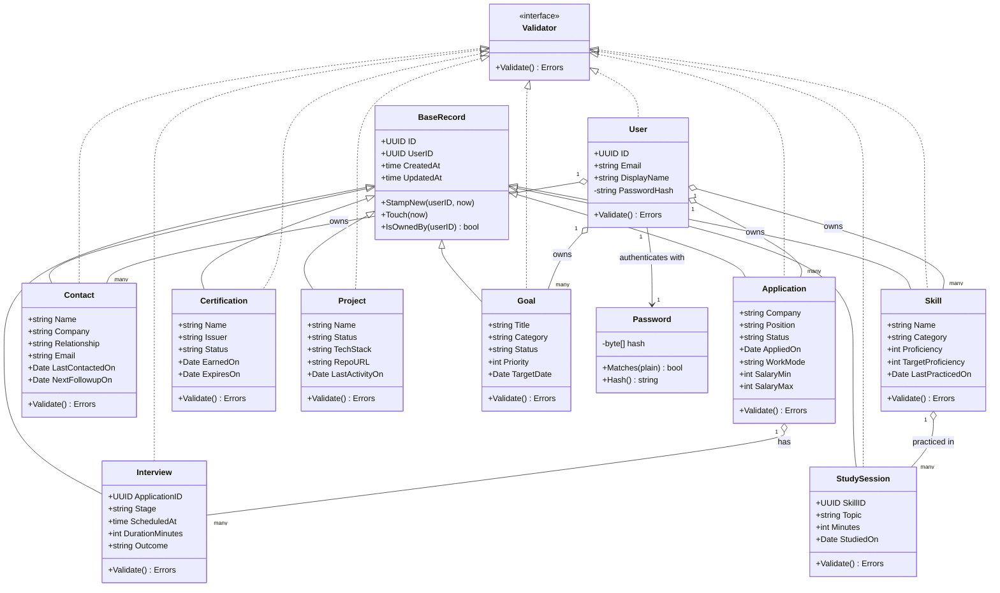
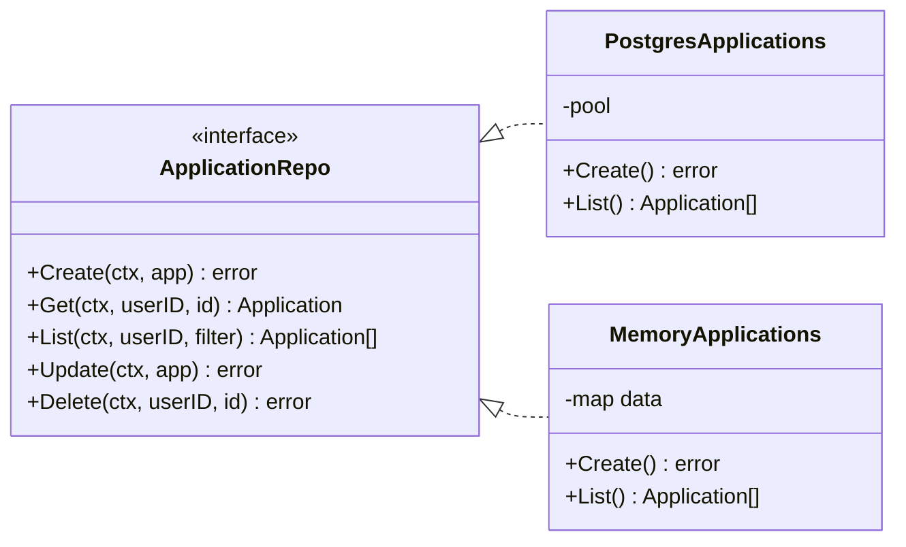
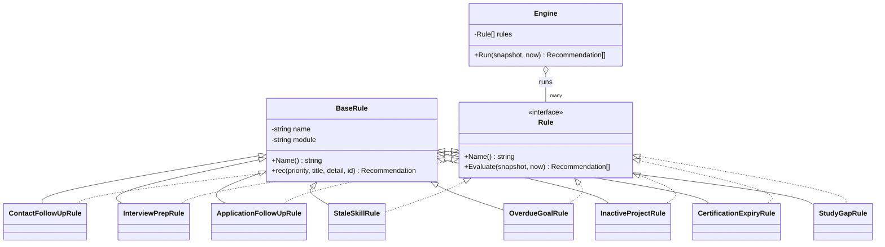

# DevSignal — UML Class Diagram

This class diagram documents DevSignal's domain model and the three
object-oriented pillars the application is built on. It is rendered with
[Mermaid](https://mermaid.js.org/); GitLab and GitHub render it inline, and it
can also be pasted into the [Mermaid Live Editor](https://mermaid.live) to
export a PNG/SVG.

- **Encapsulation** — `Password` and `Date` keep their state unexported and
  expose only safe operations. `User.PasswordHash` is excluded from JSON so a
  credential can never leak through an API response.
- **Inheritance** — every career record embeds `BaseRecord` (struct embedding
  is Go's inheritance mechanism), inheriting identity, ownership, and
  audit-timestamp behavior from one place.
- **Polymorphism** — every entity implements the `Validator` interface, so a
  single handler path (`BaseHandler.validate`) validates any record through one
  contract. Persistence is equally polymorphic: the `Repository` interfaces have
  both a PostgreSQL implementation (production) and an in-memory implementation
  (tests).

## Domain class diagram

## Repository polymorphism

Handlers and services depend only on the `repo` interfaces, never on a concrete
database. The same code runs against PostgreSQL in production and against
in-memory stores in unit tests.

## Recommendation-engine polymorphism

The rule-based recommendation engine treats every rule through the `Rule`
interface. Rules share identity via the embedded `BaseRule` (inheritance) and
keep their tuning thresholds unexported (encapsulation). Adding a rule requires
no change to the engine.

## Source of truth

The diagram is generated from the code in `backend/internal/domain/`,
`backend/internal/repo/`, and `backend/internal/recommend/`. When an entity or
rule changes, update this file to match.
